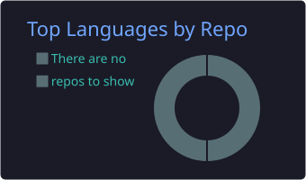

  
  

---

### Tentang

Mahasiswa yang senang membongkar cara kerja sesuatu — dari membangun antarmuka sampai memahami apa yang terjadi di balik layar.

- Fokus: **web app**, **mobile app (Flutter)**, dan **jaringan & keamanan**.
- Lebih suka membuat sesuatu yang benar-benar dipakai daripada prototype yang berhenti di lokal.
- Sedang mengerjakan **SecondLife** — marketplace barang bekas mahasiswa, dari frontend sampai backend (Cloudflare Worker + D1).

 

### Stack

 

### Statistik

 

<picture>
  <source media="(prefers-color-scheme: dark)" srcset="https://raw.githubusercontent.com/Muh-Musyawir/Muh-Musyawir/output/github-snake-dark.svg" />
  
</picture>

