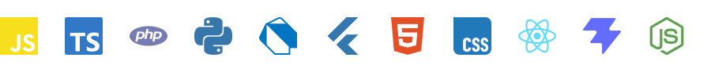
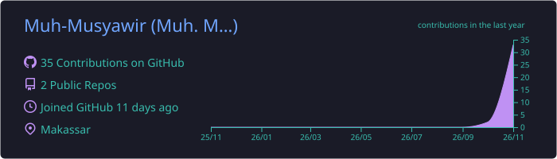
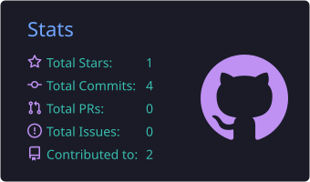
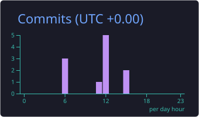

  

---

### Tentang

Tempat saya belajar pemrograman sambil membangun hal-hal kecil — latihan, eksperimen, dan catatan selama prosesnya.

- Sebagian besar isi repo di sini adalah proses belajar, bukan proyek yang sudah selesai.
- Belum memilih satu bidang; sedang mencoba beberapa hal sekaligus.
- Kalau ada yang salah atau bisa lebih baik, koreksinya diterima.

 

### Sedang dipelajari

 

### Statistik

 

<picture>
  <source media="(prefers-color-scheme: dark)" srcset="https://raw.githubusercontent.com/Muh-Musyawir/Muh-Musyawir/output/github-snake-dark.svg" />
  
</picture>

